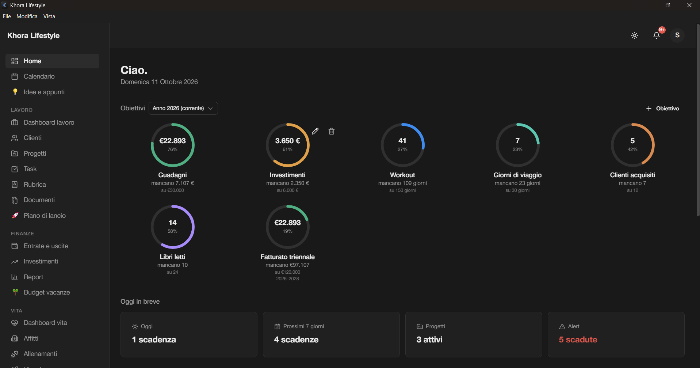
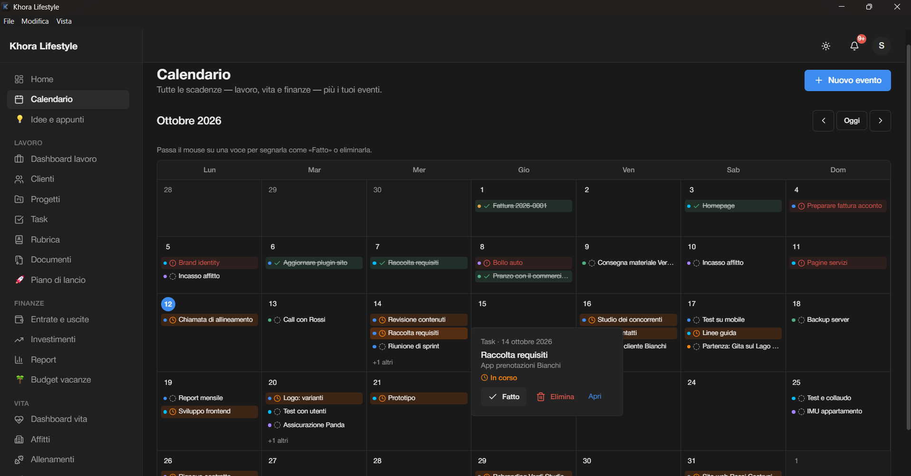
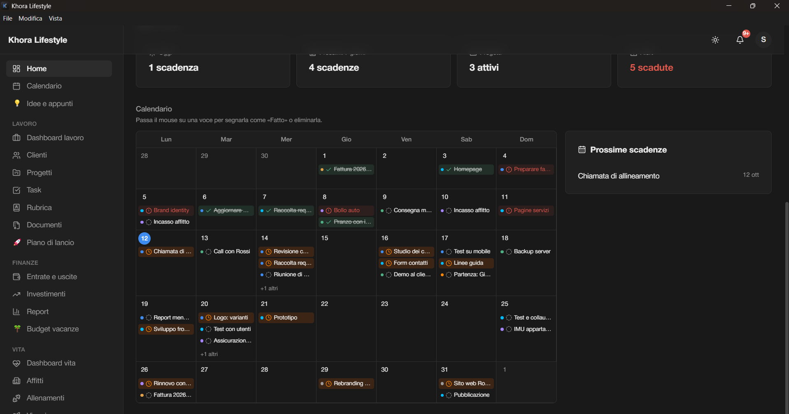
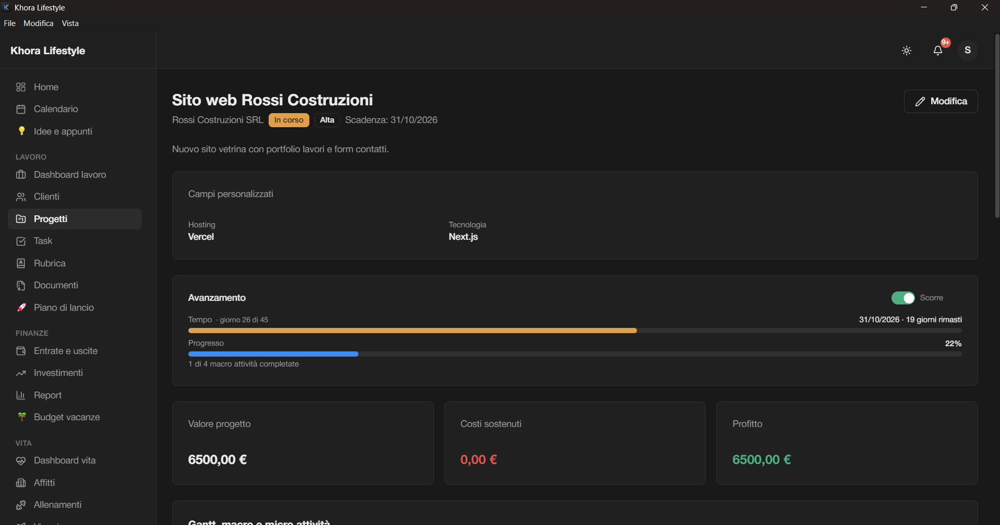
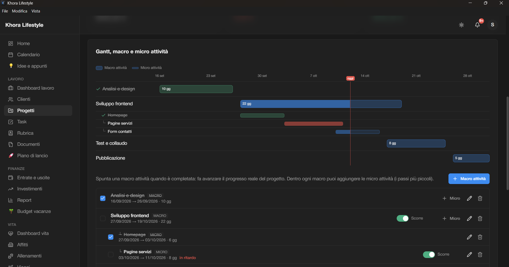
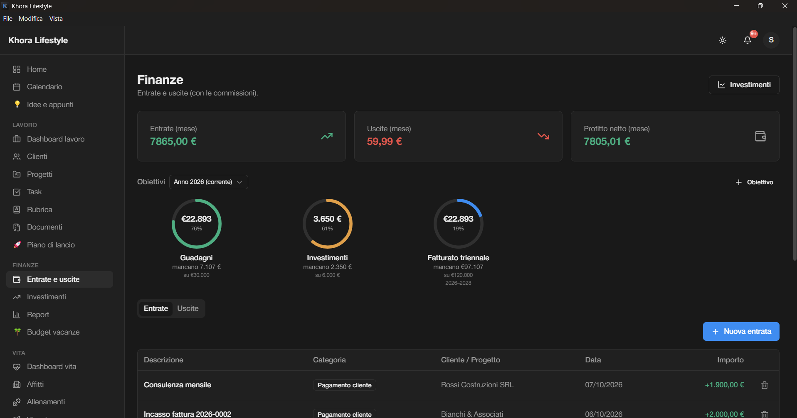
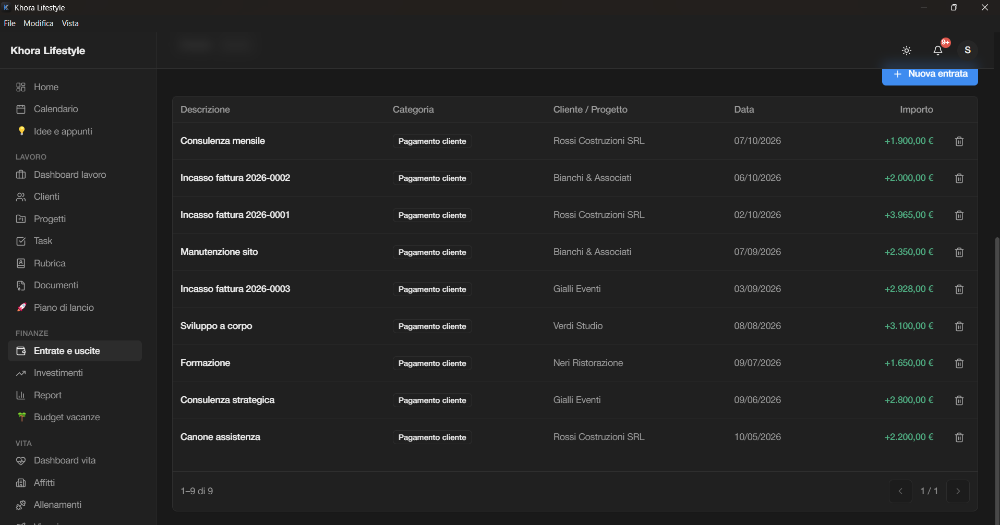
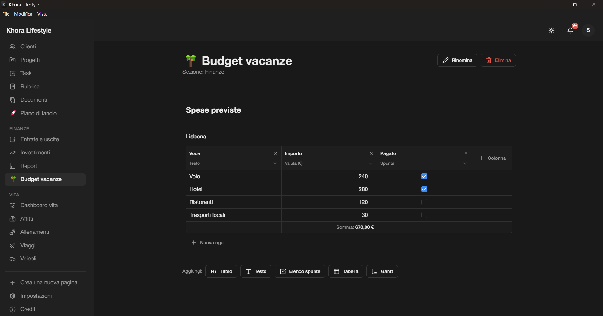

# Khora Lifestyle

> _Everything your mind shouldn't have to remember._

Khora è un gestionale personale e professionale in un'unica app web: lavoro,
finanze e vita quotidiana, con un calendario che raccoglie tutte le scadenze.
Nasce per tenere insieme in un solo posto clienti, progetti, task, entrate e
uscite, affitti, veicoli, viaggi e allenamenti, invece di sparpagliarli tra
fogli di calcolo e promemoria.



> Le schermate di questa pagina usano un account di prova con dati inventati.

## Cosa fa

### Home e calendario

- Home con **obiettivi ad anello** (anche su più anni) che si aggiornano da soli
  dai dati dell'app: fatturato, investimenti, giorni di palestra, clienti acquisiti, giorni di viaggio.
- Un riepilogo "oggi in breve" con scadenze di oggi, della settimana e in ritardo.
- **Calendario mensile** che unisce scadenze di task, progetti, macro attività,
  affitti, veicoli, viaggi ed eventi personali.
- Ogni voce ha uno **stato a colori** con legenda: verde completata, rossa scaduta,
  arancio in corso. Passando il mouse si può segnarla come _Fatto_, eliminarla o aprirla.



La stessa vista, in versione compatta, è nella Home accanto alle prossime scadenze:



### Lavoro

- **Clienti, rubrica e documenti** con file collegati.
- **Progetti** con campi personalizzati, avanzamento nel tempo e di lavoro, valore, costi e profitto.
- Ogni progetto è diviso in macro attività e micro attività, con **diagramma di Gantt**
  e avanzamento calcolato in automatico. Un progetto con tutte le macro attività
  completate passa da solo a "completato".
- **Task** con un tempo "a giorni": data di inizio + durata, con un interruttore
  _scorre / congelato_. Se il tempo è congelato la scadenza slitta di un giorno ogni giorno.
- Dashboard di lavoro e report per periodo.





### Finanze

- **Entrate e uscite** in schede separate, con categorie, cliente e progetto collegati.
- Obiettivi di fatturato e di investimento, anche su più anni.
- **Investimenti** con versamenti e prelievi, commissioni e profitto netto.





### Vita

- **Affitti** con giorno di incasso mensile e scadenze del contratto.
- **Veicoli** con scadenze (bollo, assicurazione, tagliando) e ricorrenze.
- **Viaggi** con tappe e prenotazioni, e un registro degli **allenamenti**.

### Pagine personalizzate

Ogni utente può creare nuove pagine dal menu ("Crea una nuova pagina") con blocchi di
titolo, testo, elenco spunte, tabella e **Gantt**, e metterle nella sezione che preferisce.
Le tabelle hanno colonne di testo, numero, valuta e casella da spuntare, con la somma in fondo.



### Account e sicurezza

- Registrazione con conferma via email, accesso e **recupero password**.
- Cambio password dalle impostazioni.
- Notifiche interne per le scadenze, tema chiaro e scuro, installabile come app (PWA).
- Interfaccia in italiano e adatta anche allo smartphone.

## Tecnologie

Next.js 16 (App Router) · React 19 · TypeScript · Tailwind CSS v4 · shadcn/ui ·
Supabase (Postgres, Auth, Storage) · React Hook Form + Zod · Recharts · date-fns

La sicurezza dei dati è affidata alla **Row Level Security** di Postgres:
ogni tabella è protetta, quindi un utente può leggere e scrivere solo i propri dati.
Le scritture passano da Server Action validate con Zod.

## Avvio in locale

```bash
npm install
cp .env.local.example .env.local   # inserisci URL e chiavi del tuo progetto Supabase
npm run dev
```

Poi apri [http://localhost:3000](http://localhost:3000).

Il database si crea applicando in ordine le migrazioni nella cartella
`supabase/migrations/` (SQL Editor di Supabase oppure `npx supabase db push`).

### Dati di prova

Per provare l'app con dati già inseriti (come nelle schermate qui sopra) c'è lo script
`supabase/seed-demo.sql`. Creane l'uso su un **account di prova vuoto**, mai su dati veri:

1. crea un utente da Authentication → Users nel tuo progetto Supabase;
2. imposta la sua email in `v_email` all'inizio dello script;
3. eseguilo una volta nell'SQL Editor.

Lo script si rifiuta di partire se l'account contiene già dei dati. Le date sono calcolate
rispetto al giorno in cui lo esegui.

## Documentazione

L'analisi completa (schema del database, decisioni di progetto e piano di sviluppo)
è in [`docs/architettura-gestionale.md`](docs/architettura-gestionale.md).

## Demo

Una demo online con dati di prova è disponibile su richiesta.

## Licenza

Il codice è distribuito con licenza [MIT](LICENSE). I font in `public/fonts/`
(Helvetica Neue) non fanno parte del progetto e non sono coperti da questa licenza:
restano di proprietà dei rispettivi titolari. Le immagini in `docs/screenshots/`
mostrano dati inventati.
